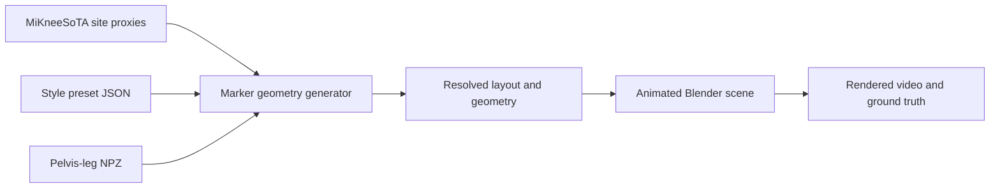

# Requirements

### Overview & Goals
Use the MiKneeSoTA Table 1 anatomical sites as **rough placement references** for markers on each SKEL pelvis-plus-one-leg mesh. Automatically project those sites to the mesh and attach the resulting patches to the deforming skin; Blender picking is not part of this workflow. Keep placement independent from marker family and appearance: a reusable style preset assigns each site any supported texture and visual shape (for example, square ArUco/STAG or circular/custom-alpha markers). The paper supplies anatomical descriptions, not mesh coordinates, so the sites remain clearly labelled approximations.

### Scope
**In scope**
- Automatically place the 17 MiKneeSoTA site proxies (four bilateral pelvis sites plus 13 sites for the selected leg) on each male/female, left/right pelvis-leg export; do not require manual Blender picking.
- Treat the paper sites as rough anatomical placement references, not as marker-family restrictions. Assign different marker families, shapes, textures, sizes, and rotations to individual sites through a separate reusable style preset.
- Support square, circular, and texture-alpha silhouettes on the existing skin-conforming marker patches; accept supplied pattern images such as ArUco or STAG textures.
- Preserve source-bound barycentric attachments, per-pose marker geometry, and the existing Blender preview/render and ground-truth workflow.
- Document the approximation limits, style configuration, and render command; add validation and automated tests.

**Out of scope**
- Claiming the proxy sites are exact clinical coordinates: the paper gives anatomical descriptions and schematic views, not coordinates on these SKEL meshes.
- Adding marker sites beyond the MiKneeSoTA-derived 17 per one-leg-plus-pelvis model, or asking the user to click placement points in Blender for this workflow.
- Implementing marker detectors, detector evaluation, marker-family image-generation libraries, or camera-based localization; users supply the marker pattern images.
- Changes to SKEL poses, mesh selection, or existing `run_pelvis.py`, `run_pelvis_leg.py`, and `run_knee_bend.py` behavior.

### User Stories
- As a researcher, I want the paper's anatomical sites mapped approximately onto the SKEL meshes automatically, so I can use them as repeatable starting positions without manually picking each point.
- As a researcher, I want to choose different marker families, textures, and visible shapes for those same sites, so the site definitions do not limit which markers I can test.
- As a researcher, I want the markers to conform to animated skin and appear in Blender renders, so I can inspect and render videos of the configured experiments.

### Functional Requirements
- Generate the same 17 MiKneeSoTA-derived site codes for each matching pelvis-leg export, with pelvis sites constrained to pelvis-labelled skin and limb sites constrained to the selected leg; do not use Blender picking to define positions.
- Read a separate style preset keyed by paper site code, with reusable defaults and per-site overrides for marker family, shape, texture path, size, and rotation. Marker family may be ArUco, STAG, or another user-supplied pattern; it does not change the site anchor.
- Render square and circular silhouettes through a UV-space alpha mask, and support custom silhouettes through texture alpha. The textured visible surface remains a deforming grid attached to the skin.
- Validate style entries, IDs, dimensions, texture paths, source fingerprint, region boundaries, and patch fit before saving generated geometry.
- Recompute each surface-grid vertex from stored face/barycentric anchors for every pose; retain the current per-frame center, bounding corners, normal, and ground-truth outputs.
- Build the configured marker patches in the existing animated `scripts/blender_import_pelvis_leg.py` scene and render the animation through `marker_tracking/blender/export_take.py`; preserve the no-marker path.

# Technical Design

### Current Implementation
- `scripts/pelvis_leg_export.py` produces the 46-pose pelvis-plus-selected-leg NPZ consumed by marker generation and Blender.
- `marker_tracking/paper_layout.py` defines the paper's site codes and maps them to approximate joint/proportion targets, then projects them to pelvis- or leg-labelled skin. `scripts/generate_mikneesota_markers.py` creates the 17-site layouts and geometry for all four gender/side exports, currently using one generated disc texture for all sites.
- `marker_tracking/layout.py` already stores per-marker texture paths, sizes, rotation, site metadata, and source fingerprint. `marker_tracking/anchors.py` fits a square surface grid and evaluates barycentric anchors for every pose.
- `scripts/blender_import_pelvis_leg.py` already loads each marker's texture, creates UV-mapped animated grid meshes with matching skin shape keys, and checks their evaluated vertices. `marker_tracking/blender/export_take.py` renders the animated scene and writes camera-space marker ground truth.

### Key Decisions
- **Paper sites define positions, not marker types.** Preserve the MiKneeSoTA site codes as automatic approximate anchor references; let the separate style preset assign ArUco, STAG, or any other supplied marker texture and shape to each code.
- **Reusable style preset.** Store defaults and per-site style overrides in a separate JSON file, apply it consistently to all four gender/side models, and copy resolved style metadata into each source-bound layout and geometry NPZ for reproducibility.
- **Keep barycentric surface attachment.** Continue using `skin_faces` face indices and barycentric samples on the exported submesh, tied to the source mesh fingerprint; do not read marker coordinates back from Blender.
- **Use texture alpha for silhouettes.** Keep the existing conforming subdivided grid and use UV-space masking for square/circular shapes; custom alpha textures can supply other silhouettes without changing anchor placement.
- **Respect focused modules.** Keep style validation/configuration in a dedicated `marker_tracking` module and rendering changes in `scripts/blender_import_pelvis_leg.py`; do not consolidate unrelated functionality into a common file.

### Proposed Changes
- **`marker_tracking/styles.py`** validates a separate style-preset JSON with defaults and per-paper-code overrides; resolve texture paths relative to the preset and validate supported silhouettes and finite sizes/rotations.
- **`marker_tracking/presets/mikneesota_marker_styles.json`** provides an editable example preset, with style entries independent of the site-position rules. Users can point to their own images, including square ArUco/STAG patterns.
- **`marker_tracking/paper_layout.py`** keeps the paper code-to-approximate-site mapping and combines each unchanged anchor with the resolved style data.
- **`marker_tracking/layout.py`** preserves and validates the resolved `family`, `shape`, `texture`, size, and rotation in source-bound layout entries; the paper code continues to identify the approximate site.
- **`scripts/generate_mikneesota_markers.py`** accepts a style-preset path, applies it while generating all four layouts and per-pose geometry, and stores the resolved style metadata and image paths in the outputs.
- **`marker_tracking/anchors.py`** retains barycentric surface fitting and exports the new per-marker style fields alongside the existing grid, center, corners, and normal data.
- **`scripts/blender_import_pelvis_leg.py`** displays each configured texture with square/circular UV alpha masks or the image's custom alpha, records family/shape metadata on marker objects, and retains animated skin-conforming grids and the no-marker path.
- **`marker_tracking/blender/export_take.py`** remains the render/export entry point; verify that configured styles appear in the rendered take while geometric ground truth remains tied to the skin anchors.

### Data Models / Contracts
The style preset is independent of the site-position table and resolves a style for each MiKneeSoTA code. Texture paths are relative to the preset unless absolute; each generated source-bound layout records resolved values:

```json
{
  "schema_version": 1,
  "defaults": {"family": "aruco", "shape": "square", "texture": "textures/aruco.png", "size_m": 0.04},
  "sites": {
    "LASI": {"family": "stag", "shape": "square", "texture": "textures/stag.png"},
    "RPSI": {"family": "custom", "shape": "circle", "texture": "textures/round.png", "size_m": 0.014}
  }
}
```

Each generated marker layout entry contains the stable paper `id`/`paper_code`, `site_region`, `family`, `shape` (`square`, `circle`, or `texture_alpha`), `texture`, `size_m`, `rotation_deg`, and its source-submesh face+barycentric center anchor. The geometry NPZ carries the same style fields plus the existing per-pose `surface_face (M,K,K)`, `surface_bary (M,K,K,3)`, `grid_verts (P,M,K,K,3)`, `centre (P,M,3)`, `corners (P,M,4,3)`, and `normal (P,M,3)` data. Position anchors remain unchanged by style selection.

### File Structure
```text
marker_tracking/styles.py                              (new: style preset parsing and validation)
marker_tracking/presets/mikneesota_marker_styles.json  (new: editable example style preset)
marker_tracking/layout.py                              (modified: resolved marker family/shape fields)
marker_tracking/anchors.py                             (modified: preserve style metadata in geometry)
marker_tracking/paper_layout.py                        (modified: apply style data without changing site anchors)
scripts/generate_mikneesota_markers.py                 (modified: accept reusable style preset)
scripts/blender_import_pelvis_leg.py                   (modified: per-marker shapes/textures in animated scene)
marker_tracking/tests/test_styles.py                   (new: preset validation and style resolution)
marker_tracking/tests/test_paper_layout.py             (modified: positions remain stable across style choices)
marker_tracking/tests/test_layout.py                   (modified: style fields survive validation)
marker_tracking/README.md                              (modified: configure, preview, and render styles)
output/pelvis/                                          (generated layouts, geometry, and renders; git-ignored)
```

### Architecture Diagram


### Risks
- **Proxy sites are approximate.** Keep the paper descriptions and mesh-projection distances in the generated metadata; do not claim subject-specific palpation accuracy.
- **A marker patch crosses a region boundary or high curvature.** Retain current region, fit, and fold validation and reject styles whose configured footprint cannot fit at that site.
- **Style image paths or alpha are invalid.** Validate files and shape settings before geometry generation; fail with the paper code and offending preset field.
- **Markers float or z-fight in renders.** Keep the display-only normal offset and report ground-truth points on the actual attached skin.
- **Marker-family scope expands.** Treat family as descriptive style metadata and texture as user-supplied input; do not add detector or family-image-generation dependencies.

# Marker Placement Design

### Placement Workflows
For this workflow, automatically map the MiKneeSoTA paper's named anatomical sites to approximate targets on each gender/side pelvis-leg mesh. These targets are only rough references for placing different marker types; they are not exact coordinates supplied by the paper. Do not require manual Blender picking.

### Placement and Attachment
1. `marker_tracking/paper_layout.py` calculates the 17 fixed site targets from the existing joint and pelvis geometry and projects each target to an allowed pelvis or selected-leg skin triangle.
2. A separate style preset maps each paper code to a marker family, texture, visual shape, size, and rotation. This changes appearance and footprint only; it does not choose or move the site center.
3. `marker_tracking/anchors.py` creates a configurable grid around each center, stores samples as local face+barycentric anchors, and rejects patches that cross the declared region, fail fit tolerance, or fold.
4. Re-evaluate those anchors from each pose's `skin_verts` so marker patches conform to the moving surface and expose per-pose centers, bounding corners, normals, and grid vertices without Blender readback.
5. Load the configured images and shape masks in the animated Blender scene; use a small display-only normal offset while retaining ground truth on the skin surface.

### Layout Provenance and Experiments
- Keep source mesh fingerprints and paper site IDs so generated layouts cannot silently attach to a different gender, side, or topology.
- Reuse one style preset across all four source meshes, with per-site overrides; generated source-bound layouts record resolved styles so later previews are reproducible.
- The existing Blender surface picker remains available for other workflows but is not used to define these MiKneeSoTA-referenced sites.

# Testing

### Validation Approach
Test style configuration and marker geometry with the existing Python test suite; use Blender integration checks to verify the configured marker objects follow the source skin and render correctly across the 46 poses.

### Key Scenarios
- One reusable style preset resolves defaults and per-site overrides consistently for male/female and right/left models while preserving the same 17 paper site codes and anchors.
- Square ArUco/STAG-style textures, circular masks, and custom-alpha textures survive preset → layout → geometry → Blender object round-trip with the right family/shape metadata.
- Generated grid vertices remain attached to their corresponding skin positions for every pose; Blender's evaluated marker meshes match the generated geometry within the existing tolerance.
- Rendered takes show the configured styles and preserve stable marker IDs and camera-space geometric ground truth.

### Edge Cases and Regression
- Reject missing texture images, malformed style fields, unsupported shapes, unknown paper codes, invalid dimensions, stale fingerprints, and region-crossing or folded patches with actionable errors.
- Verify style changes do not change paper site anchors or the marker count for any of the four source exports.
- Run the existing marker-tracking tests and confirm the Blender no-marker path and knee/pelvis-leg exports remain unchanged.

# Delivery Steps

### * Step 1: Add reusable per-site marker style presets to the MiKneeSoTA generator
The four generated layouts keep the existing 17 approximate paper-site anchors and resolve an independently configurable family, shape, texture, and size for each site.

- Add focused style-preset parsing and validation in `marker_tracking/styles.py`, with an editable example in `marker_tracking/presets/mikneesota_marker_styles.json`.
- Update `marker_tracking/paper_layout.py`, `marker_tracking/layout.py`, and `scripts/generate_mikneesota_markers.py` to apply style defaults and paper-code overrides without changing the existing site target calculations.
- Persist resolved family/shape/texture metadata in each layout and marker geometry NPZ; retain source fingerprints and relative texture path resolution.
- Add tests proving styles round-trip, invalid presets fail clearly, and changing styles leaves marker IDs, site codes, and barycentric centers unchanged across all four models.

###   Step 2: Render configured marker silhouettes and textures on the animated skin
The Blender scene displays square, circular, and custom-alpha markers that follow the skin over the full animation and can be rendered as a video.

- Update `scripts/blender_import_pelvis_leg.py` to apply per-marker UV-space shape masks and supplied textures, retain family/shape metadata on Blender objects, and preserve the no-marker scene path.
- Keep marker grids on the existing shape-key timeline and retain the small display offset; do not change skin anchors or ground-truth coordinates.
- Verify generated marker meshes against the NPZ at each pose, render a take through `marker_tracking/blender/export_take.py`, and check that output images visibly show the selected styles and ground truth retains stable IDs.
- Document the style preset, image-path rules, four-model generation command, and Blender render workflow in `marker_tracking/README.md`; run layout, anchor, paper-layout, and regression tests.