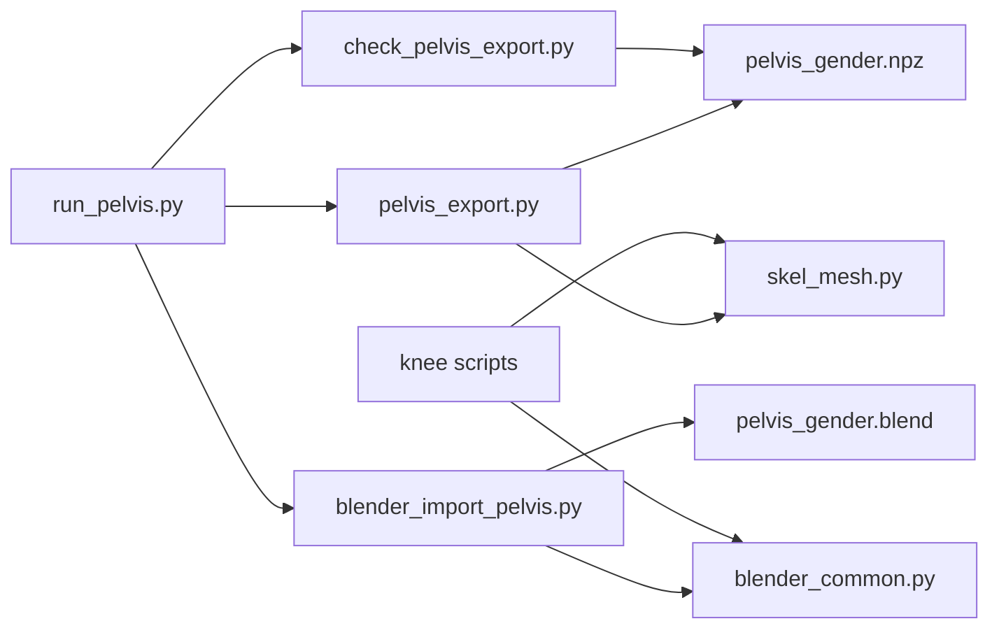

# Requirements

### Overview & Goals
Create a static (non-animated) **pelvis-only** case next to the existing knee-bend pipeline, plus an animated pelvis-attached leg case for all gender/side combinations. Outputs go to `output/pelvis/`. Also write down how skin markers (ArUco / STag / CCTag) will be attached later, so they stick to the skin completely and their exact positions can be read back. **Markers are design-only for now; they will not be implemented.**

### Scope
**In scope**
- Pelvis export: SKEL reference pose (all 46 pose params = 0, betas = 0) → `output/pelvis/pelvis_<gender>.npz`.
- Region = SKEL bone `0` (`pelvis`) only, for both the bone mesh and the skin mesh.
- Automatic validation of the `.npz`.
- A static Blender scene `output/pelvis/pelvis_<gender>.blend` with `Skin` and `Bones` objects, plus a camera and lights.
- A one-command runner for `male`, `female` or `all`, with `--force` overwrite protection.
- Animated pelvis-plus-one-leg exports and Blender scenes for male/female × right/left, using the existing 0–90° knee-bend trajectory.
- A separate `run_pelvis_leg.py` runner so `run_pelvis.py` keeps its existing static-only behavior.
- README section.
- Marker attachment design (see the *Marker Design* tab).

**Out of scope**
- Pelvis or leg motions beyond the existing single-knee 0–90° flexion trajectory.
- Implementing markers, generating marker images, or the experiment sweeps over marker size, position and number.
- Any change in behaviour of the knee-bend pipeline.

### User Stories
- As a researcher, I want a pelvis-only skin + bone model so I can study skin-marker tracking of the pelvis, as I already do for the femur and tibia.
- As a researcher, I want the pelvis ground truth in the same `.npz` layout as the knee export, so later marker tooling works on both.
- As a researcher, I want a documented marker attachment design, so I can plan experiments over marker size, position and number before anything is built.

### Functional Requirements
- `python run_pelvis.py male` (or `female` / `all`) runs three steps: export → check → Blender build. It stops at the first failure.
- It refuses to overwrite an existing `.blend` unless `--force` is given (same as `run_knee_bend.py`).
- The `.npz` contains only vertices whose dominant skinning bone is `0`, and only faces whose 3 vertices all qualify. The vertex order is fixed and deterministic.
- The `.blend` opens with a semi-transparent `Skin` (same material as the knee scene) and an opaque `Bones` pelvis. It uses the same RealSense D456 camera intrinsics, viewing the pelvis **from the front**.
- Animated pelvis-leg exports contain only vertices dominated by pelvis bone `0` or bones of the selected leg, with faces kept only when all three vertices qualify. They use the same 46 poses and knee angles as the matching knee-bend export.
- Animated pelvis-leg scenes use the same absolute shape-key motion and frame mapping as the knee scene, with pelvis and selected leg in both `Skin` and `Bones`.
- Existing `run_knee_bend.py` outputs are unchanged.

# Technical Design

### Current Implementation
- `scripts/knee_bend_export.py`:
  - `dominant_bone(weights)` does an argmax over `skel.skin_weights` / `skel.skel_weights_rigid`.
  - `submesh(faces, vert_bone, bones)` keeps faces whose vertices all lie in the chosen bones, and renumbers them.
  - It writes the `.npz` (`skin_verts`, `skin_faces`, `skin_vert_ids`, `skin_label`, `bone_*`, `joints`, `bone_transforms`, …).
  - All the code runs at module level, so the helpers can't be imported.
- `scripts/check_export.py` is specific to the knee (it uses `knee_deg` and femur/tibia checks).
- `scripts/blender_import_knee.py`:
  - Contains `to_blender`, `make_material`, `make_animated_mesh`, `add_camera_and_lights` (side view along ±x), and `check_frames`.
  - It ends with a bare `main()` call.
- `run_knee_bend.py` contains `find_blender()` and `run(step, cmd)`, guarded by `__main__`, so both can be imported.
- SKEL bone indices (`skel/kin_skel.py`): `0 pelvis`, `1/6 femur`, `11 lumbar_body`.

### Key Decisions
- **Region = pelvis bone 0 only** (user choice). This is the direct counterpart of `LEG_BONES`.
- **Outputs = `.npz` + static `.blend`** in `output/pelvis/` (user choice). The `.npz` keeps the knee schema, with pose axis `P = 1`, so later animation and marker code can treat both cases the same way.
- **Share helpers instead of copying them.**
  - Move `dominant_bone` and `submesh` into `scripts/skel_mesh.py`.
  - Move `to_blender`, `make_material` and `add_camera_and_lights` into `scripts/blender_common.py`.
  - The knee scripts import them, with identical behaviour.
- **Front view for the pelvis.** `add_camera_and_lights` gets a `view='side'|'front'` keyword. The default `'side'` keeps the knee scene exactly as it is. `'front'` puts the camera at −y in Blender, the subject's front (SKEL +z → Blender −y).
- **Static mesh, no shape keys.** With a single pose, the mesh is built straight from `verts[0]`.

### Proposed Changes
- **`scripts/pelvis_export.py`** (`--gender male|female`):
  - Loads SKEL with `load_skel`.
  - Evaluates one zero pose under `torch.no_grad()`.
  - Selects bone `[0]` with the shared helpers.
  - Builds `bone_transforms` the same way as the knee export.
  - Saves the arrays (see the contract below).
- **`scripts/check_pelvis_export.py`** prints PASS/FAIL in the same style as `check_export.py`. It checks:
  - all arrays are present and their shapes agree (`P == 1`);
  - there are no NaN or inf values, and all coordinates are < 2 m from the origin;
  - faces and vertex ids are valid and the ids are unique and sorted;
  - every `skin_label` and `bone_label` is 0, and all poses are 0;
  - the pelvis joint `joints[0, 0]` lies inside the pelvis bone's bounding box;
  - the centre of the bone bounding box lies inside the skin bounding box;
  - it also reports the number of connected skin components (as information).
  - `--recompute` re-runs SKEL and compares the vertices.
- **`scripts/blender_import_pelvis.py`** (run inside Blender, arguments after `--`: `npz blend [--force]`):
  - Builds a static `Skin` (alpha 0.3) and `Bones` (pelvis material).
  - Adds the camera and lights with `view='front'`.
  - Checks that the Blender vertex coordinates equal `to_blender(npz)` to within < 1e-5 m, then saves.
  - Sets the scene properties `gender` and `region='pelvis'`.
- **`run_pelvis.py`** (repo root): `gender ∈ {male, female, all}` plus `--force`. It reuses `find_blender` and `run` from `run_knee_bend.py` and writes to `output/pelvis/`.
- **Knee scripts:**
  - `knee_bend_export.py` imports its helpers from `skel_mesh.py`.
  - `blender_import_knee.py` imports its helpers from `blender_common.py`, and its call becomes `if __name__ == '__main__': main()` (Blender's `--python` sets `__main__`).
  - Neither script's behaviour changes.

### Data Models / Contracts
```python

# scripts/skel_mesh.py

def dominant_bone(weights) -> np.ndarray            # (V,) argmax bone per vertex
def submesh(faces, vert_bone, bones) -> (vert_ids, new_faces)
def bone_transforms(joints, joints_ori) -> np.ndarray  # (P, 24, 4, 4)

# scripts/blender_common.py

def to_blender(v): ...                               # SKEL y-up -> Blender z-up
def make_material(name, color, alpha=1.0): ...
def add_camera_and_lights(scene, points, mirror=1, view='side'): ...
```
`output/pelvis/pelvis_<gender>.npz` uses the knee schema minus `knee_deg`, plus `region`:

| Array | Shape | Note |
|---|---|---|
| `poses`, `pose_param_names` | (1, 46), (46,) | all zeros |
| `skin_verts`, `skin_faces`, `skin_vert_ids`, `skin_label` | (1, Vs, 3), (Fs, 3), (Vs,), (Vs,) | label == 0 |
| `bone_verts`, `bone_faces`, `bone_vert_ids`, `bone_label` | (1, Vb, 3), (Fb, 3), (Vb,), (Vb,) | label == 0 |
| `joints`, `joint_names`, `bone_transforms` | (1, 24, 3), (24,), (1, 24, 4, 4) | pelvis = index 0 |
| `gender`, `betas`, `trans`, `region`, `units`, `coordinate_system` | | `region='pelvis'` |

### File Structure
```
run_pelvis.py                     (new)
scripts/skel_mesh.py              (new, helpers moved from knee_bend_export.py)
scripts/blender_common.py         (new, helpers moved from blender_import_knee.py)
scripts/pelvis_export.py          (new)
scripts/check_pelvis_export.py    (new)
scripts/blender_import_pelvis.py  (new)
scripts/knee_bend_export.py       (modified: imports helpers)
scripts/blender_import_knee.py    (modified: imports helpers, __main__ guard)
README.md                         (modified: Pelvis section)
output/pelvis/                    (generated, git-ignored)
```

### Architecture Diagram


### Risks
- **Ragged or patchy skin border.** Selecting by dominant bone can leave small islands where pelvis, femur and lumbar weights are close. The checker reports the component count. Anchoring markers far from the border avoids the issue (see Marker Design).
- **Knee regression from the refactor.** Mitigation: compare the refactored selection with the ids already stored in `output/knee_bend/*.npz`, and rebuild one knee scene into a scratch path to confirm `check_frames` still passes.
- **Imports inside Blender.** The pelvis importer must add `scripts/` to `sys.path` before importing `blender_common`.

# Marker Design (deferred)

### Goal
Markers must **stick completely to the skin**, so they deform with it like a tattoo, and their exact 3D centre and corners must be known in every frame for ground truth. **Nothing here is implemented in this task.** Implementation waits until you define the experiment sweeps over size, position and number.

### Chosen approach: barycentric anchors (user choice)
1. **Layout config** (one JSON per experiment, e.g. `marker_layouts/<exp>.json`):
```json
{"region": "pelvis", "family": "aruco_4x4_50" | "stag_hd11" | "cctag3",
 "markers": [{"id": 0, "size_m": 0.03, "anchor": {"vert_id": 1234} | {"face": 87, "bary": [0.2,0.3,0.5]},
              "rotation_deg": 0}]}
```
2. **Placement at rest pose:**
   - Centre `p = Σ bᵢ vᵢ` on the anchor triangle.
   - Normal `n` from the interpolated vertex normals.
   - Tangent `t` = a reference axis (e.g. Blender up) projected onto the tangent plane, then rotated by `rotation_deg`.
   - Build a k×k grid of the square marker in the (t, n×t) plane, and project each grid point onto the closest point of the skin.
   - Store each grid point as `(face, bary)` on the full SKEL skin. Using `skin_vert_ids` maps submesh faces to the full mesh.
3. **Per frame:** recompute every grid point from that frame's skin vertices, so the marker follows the skin deformation exactly. Ground truth per frame = centre, the 4 corners and the normal. These are exact; nothing needs to be read back from Blender.
4. **Blender:** draw a marker mesh (the k×k grid) offset by ~0.1 mm along the normal to avoid z-fighting. UV-map it to the marker image and animate it with the same shape-key frames as `Skin`.
5. **Output:** `markers_<exp>.npz` containing `marker_id`, `family`, `size_m`, `anchors (M, k*k, 2)`, `centre (P, M, 3)`, `corners (P, M, 4, 3)`, `normal (P, M, 3)`. Later, `marker_tracking/blender/export_take.py` converts these into `ground_truth.csv`. `marker_id` is the same id used in `marker_tracking/table.py`.

### Marker families
- **ArUco:** images come from `cv2.aruco.generateImageMarker` (opencv-contrib). Detection is easy in `marker_tracking/detect.py`.
- **STag:** use the pre-generated HD-library images from the `manfredstoiber/stag` repo. Detection via the `stag-python` bindings.
- **CCTag:** circular rings from `alicevision/cctag`. Detection needs a C++ build, which is the main Windows risk. The centre is more robust under curvature, but there are no corners (store the centre and normal only).

### Experiment sweeps (later)
A generator writes one layout per combination of {size, number, placement strategy (landmark vertices, random with minimum spacing, grid)}. It rejects placements whose grid would cross the region border or fold over high-curvature areas.

# Testing

### Validation Approach
Use the project `.venv` and the installed Blender. The SKEL models are already present, as `output/knee_bend/` shows.

### Key Scenarios
- `python scripts/pelvis_export.py --gender male` writes `output/pelvis/pelvis_male.npz` with plausible counts: thousands of bone vertices and several hundred skin vertices.
- `python scripts/check_pelvis_export.py output/pelvis/pelvis_male.npz --recompute`: all checks PASS.
- `python run_pelvis.py all` builds `pelvis_male.blend` and `pelvis_female.blend`. Blender's vertex check passes, and reopening the file in headless Blender shows `Skin` and `Bones` with the expected vertex and face counts.

### Edge Cases
- Running `run_pelvis.py male` a second time without `--force` exits with the "already exists" message, and with `--force` it overwrites.
- A missing model file shows the existing `load_skel` error.
- If no Blender is found, the run stops with the `find_blender` message.

### Regression (knee pipeline)
- The refactored `submesh`/`dominant_bone` reproduce `skin_vert_ids`, `skin_faces`, `bone_vert_ids` and `bone_faces` stored in the existing `output/knee_bend/knee_bend_anim_male_right.npz` exactly.
- `blender_import_knee.py` run on the existing `.npz` into a scratch `.blend` passes `check_frames`, and the camera position is unchanged (`view='side'` default).
- `check_export.py` still passes on the existing knee `.npz`.

# Delivery Steps

### ✓ Step 1: Extract shared SKEL mesh helpers and add the pelvis export
`scripts/pelvis_export.py` writes `output/pelvis/pelvis_<gender>.npz` with pelvis-only skin and bone; the knee export behaves exactly as before.

- Create `scripts/skel_mesh.py` with `dominant_bone`, `submesh` and `bone_transforms`, moved from `knee_bend_export.py`.
- Update `scripts/knee_bend_export.py` to import these helpers, with no change in behaviour.
- Add `scripts/pelvis_export.py`:
  - `--gender` argument;
  - one zero pose (`P = 1`);
  - bone set `[0]`;
  - the knee `.npz` schema minus `knee_deg`, plus `region='pelvis'`.
- Verify that the refactored selection reproduces the ids and faces stored in `output/knee_bend/knee_bend_anim_male_right.npz`.
- Run the pelvis export for male and female and inspect the vertex and face counts.

### ✓ Step 2: Add validation for the pelvis export
`scripts/check_pelvis_export.py` checks a pelvis `.npz` and exits non-zero on any failure.

- Use PASS/FAIL output in the same style as `check_export.py`.
- Check that all arrays are present and that shapes agree with `P == 1`.
- Check for NaN/inf values and that coordinates are plausible.
- Check face validity, and that vertex ids are unique and sorted.
- Check that every label is 0 and every pose is 0.
- Check that the pelvis joint lies inside the bone's bounding box, and that the bone sits inside the skin's bounding box.
- Report the number of connected skin components for information.
- Add an optional `--recompute` that compares against a fresh SKEL evaluation.
- Run the checker on both gender exports, with `--recompute`.

### ✓ Step 3: Build the static pelvis Blender scene and runner
`python run_pelvis.py male|female|all [--force]` produces `output/pelvis/pelvis_<gender>.blend`; the knee scene is unchanged.

- Create `scripts/blender_common.py` with `to_blender`, `make_material` and `add_camera_and_lights`.
  - `add_camera_and_lights` gains a `view='side'|'front'` keyword; `'side'` keeps the current knee behaviour.
- Update `scripts/blender_import_knee.py` to import these helpers and to call `main()` under an `if __name__ == '__main__'` guard.
- Add `scripts/blender_import_pelvis.py`:
  - static `Skin` and `Bones` meshes, no shape keys;
  - front camera and lights;
  - a vertex check against the `.npz`;
  - scene properties `gender` and `region`;
  - `--force` support.
- Add `run_pelvis.py`, which reuses `find_blender` and `run` from `run_knee_bend.py` and runs export → check → Blender into `output/pelvis/`.
- Verify:
  - `run_pelvis.py all` succeeds;
  - overwrite protection works;
  - a knee scene rebuilt into a scratch path still passes `check_frames`.
- Add a "Pelvis (static)" section to `README.md` with the commands, the outputs, and a pointer to the deferred marker design.

### ✓ Step 4: Revise the plan for animated pelvis-plus-leg cases
Keep the completed static pelvis-only output, and extend the deliverable with a pelvis-attached knee-bend case for every gender/side combination. Each animated case must use the same leg selection and pose trajectory as the corresponding knee export, with pelvis included in its skin and bone meshes.

- Outputs: `output/pelvis/pelvis_leg_anim_<gender>_<side>.npz` and `output/pelvis/pelvis_leg_<gender>_<side>.blend`.
- `python run_pelvis_leg.py all` builds all four gender/side cases; one gender may be selected with an optional side (default `right`), and `--force` controls overwrite.
- Keep `run_pelvis.py` and its static pelvis outputs unchanged. Share the existing knee export/animation implementation where practical, without moving domain-specific behavior into a catch-all common module.
- The exported region is pelvis bone `0` plus the selected leg bones (`1–5` right or `6–10` left); animation remains the standard 46 poses from 0° to 90° for that side's knee only.
- Add explicit implementation and verification steps for the four animated cases, exact mesh/pose validation, and knee regression coverage.

### ✓ Step 5: Export and validate animated pelvis-plus-leg cases
Add a pelvis-leg exporter and validator that produce the same pose schema and motion as the corresponding knee export, while retaining pelvis and the selected leg.

- Reuse or narrowly refactor the knee export path so normal knee outputs remain byte/schema compatible and the pelvis-leg cases use identical poses, weights, and deterministic submesh selection.
- Include `region`, `gender`, and `side` metadata; verify dominant labels are restricted to pelvis and the chosen leg.
- Validate all four cases, including pose columns, faces/IDs, pelvis and leg presence, and optional fresh-SKEL recomputation.

### ✓ Step 6: Build animated pelvis-leg scenes and runner
Create animated Blender scenes for the four pelvis-attached leg cases and document the new workflow.

- Add `scripts/blender_import_pelvis_leg.py` using the knee importer's existing shape-key/frame behavior; validate both skin and bone vertices against all exported poses before saving.
- Add `run_pelvis_leg.py` with export → check → Blender steps, all four cases via `all`, and `--force` overwrite protection.
- Preserve existing `run_pelvis.py` static behavior and all knee outputs; add the animated workflow and file naming to `README.md`.
- Verify four outputs, animation frame checks, overwrite handling, and knee regression checks.