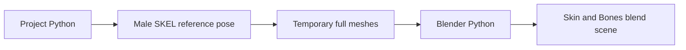

# Requirements

### Goal
Create one standalone script that generates a Blender scene of the complete male SKEL model in its zero-parameter reference pose, with separate skin and bone objects available for inspection.

- Do not bend, crop, animate, or otherwise alter the model geometry.
- Keep the existing knee-bend pipeline unchanged.
- Save a `.blend` file that can be opened in Blender; protect an existing output from accidental overwrite.

# Technical Design

### Approach
Use the existing `scripts/skel_setup.py` loader and the zero-valued pose, shape, and translation inputs demonstrated in `scripts/knee_bend.py`. Preserve the full `skin_verts`, `skel_verts`, `skin_f`, and `skel_f` arrays without submesh selection or topology processing.

Run the new script in two phases, following the separate Python environments used by `run_knee_bend.py`:
1. Project Python loads the male model, evaluates it under `torch.no_grad()`, writes temporary mesh arrays, and launches Blender using the existing `find_blender()` discovery rules.
2. Blender runs the same script in its internal phase, creates separate `Skin` and `Bones` mesh objects directly from those arrays, and saves the scene. Temporary files are cleaned up on success or failure.

Keep vertex coordinates and indices unchanged. Set the objects' display rotation to convert SKEL’s Y-up coordinates to Blender’s Z-up convention, as in `scripts/blender_import_knee.py`, without modifying their mesh data. Frame the full body in Blender's solid viewport; the skin can be hidden in the Outliner to inspect the bones.

### Files and interface
- Add `scripts/view_skel_male.py`, invoked as `python scripts/view_skel_male.py` from the repository root. Save to `output/skel_male/skel_male.blend`; support `--force` to replace it.
- Update `README.md` with the command, output path, and how to toggle skin visibility.
- Reuse the existing model-file error from `load_skel()` and Blender discovery/error behavior from `run_knee_bend.py`; report subprocess failures without claiming a scene was saved.

### Architecture

# Testing

### Validation
- Compare both imported mesh vertex arrays and face indices with the full SKEL outputs before saving; reopen the scene in Blender and verify both objects and their full vertex/face counts.
- Check the reference-pose inputs are all zero, the objects have the intended display rotation, and the viewport frames the body.
- Exercise existing-output protection, `--force`, missing model or Blender, subprocess failure, and temporary-file cleanup. Run a real end-to-end check when the licensed model and Blender are available; otherwise report the limitation.

# Delivery Steps

### ✓ Step 1: Load the full male reference model
The new script evaluates the complete male model without changing its pose or topology.

- Add `scripts/view_skel_male.py` with a project-Python entry point and `--force` output protection.
- Reuse `load_skel('male')`, zero-valued input tensors, and `torch.no_grad()`.
- Preserve full skin and bone vertices and faces in a temporary exchange file.
- Reuse Blender discovery, launch the same script in Blender, and clean up temporary data on failures.
- Check missing dependencies, overwrite protection, and subprocess errors.

### * Step 2: Build and document the Blender scene
The generated `.blend` opens with separate full-body skin and bone objects ready to inspect.

- Implement the Blender phase using the exchanged arrays and apply only the SKEL-to-Blender display rotation.
- Frame the model in the solid viewport and save `output/skel_male/skel_male.blend`.
- Verify original vertices and topology are preserved and both objects survive reopening.
- Document the command, output, and skin visibility toggle in `README.md`.